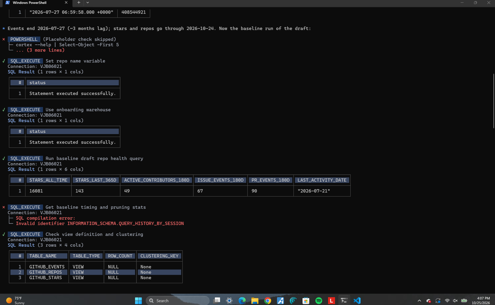
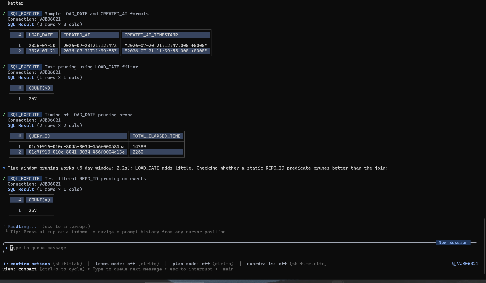
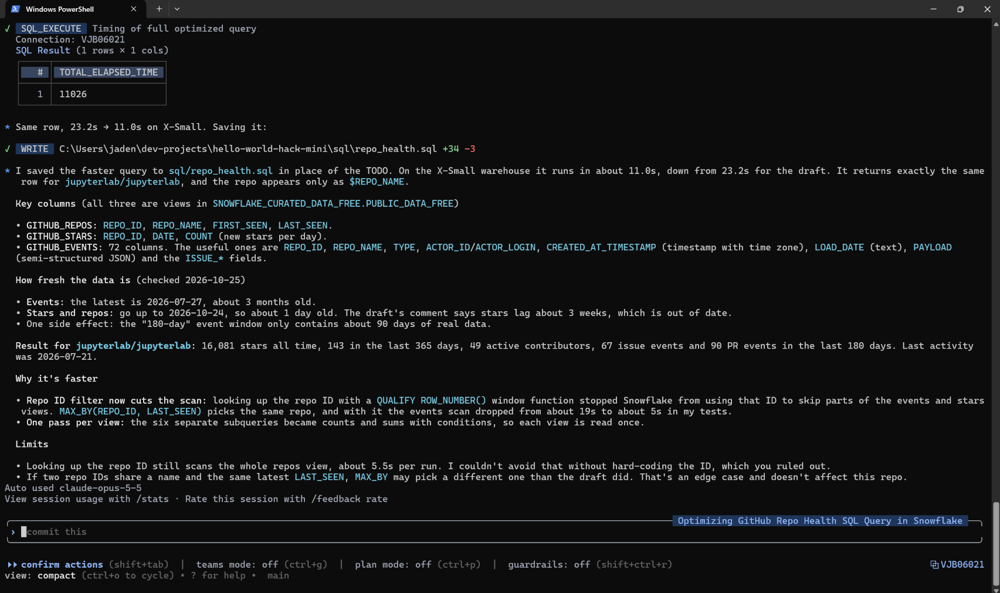
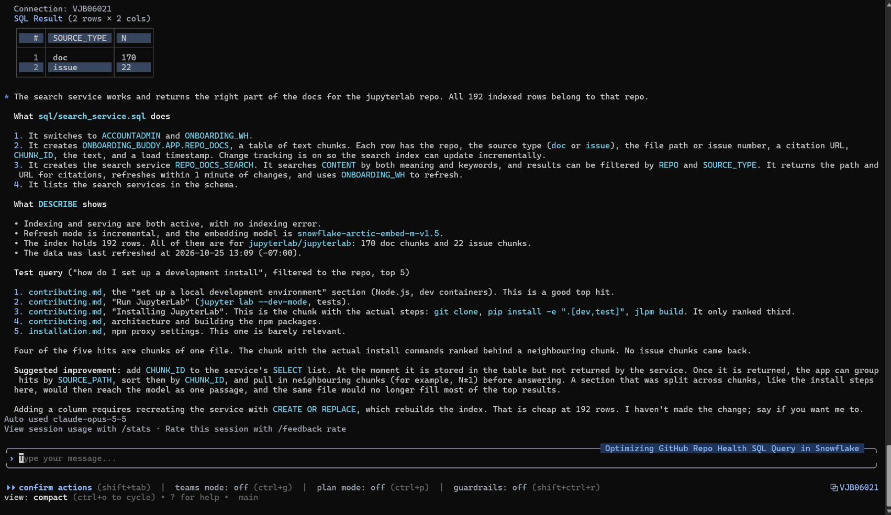

# 🧭 Onboarding Buddy

**Chat with any GitHub repo's docs and issues, with every answer cited. Built on Snowflake.**

New contributors lose hours digging through scattered READMEs, docs and old issues just to get set up, and maintainers answer the same questions again and again. Paste a repo URL into Onboarding Buddy and it:

1. **Loads** the README, contributing guide, `docs/` and the most-discussed closed issues into a **Snowflake** table
2. **Indexes** them with **Snowflake Cortex Search** (hybrid vector + keyword search)
3. **Answers** questions with an **open-weight LLM on Snowflake Cortex AI** (`AI_COMPLETE`), citing the exact file or issue
4. **Builds** a "Getting started" checklist from the docs
5. **Suggests good first issues**, preferring unassigned and less-crowded ones
6. **Shows repo health** (stars, active contributors, issue/PR activity) from the free **GitHub Archive** dataset on the **Snowflake Marketplace**

Built at Hacktoberfest × Purdue Hello World (MLH) for **Best Open-Source AI Project** and **Best Open-Source AI Project with Snowflake**.

## Architecture

```
GitHub repo URL
   │  github_fetch.py (GitHub REST API + raw files)
   ▼
ONBOARDING_BUDDY.APP.REPO_DOCS          ← chunks of docs + closed issues (Snowflake table)
   │  Cortex Search service REPO_DOCS_SEARCH (embeddings: snowflake-arctic-embed-m-v1.5)
   ▼
SEARCH_PREVIEW(query, filter REPO)      → top chunks
   │  AI_COMPLETE('llama3.3-70b', prompt with numbered sources)
   ▼
Answer with [1][2] citations  ·  checklist  ·  good first issues
                                         ▲
SNOWFLAKE_CURATED_DATA_FREE.PUBLIC_DATA_FREE.GITHUB_* ───┘ repo health (Snowflake Marketplace, written with CoCo)
```

All retrieval, generation and analytics run **inside Snowflake**. Streamlit is just the UI.

## Open-source / open-weight AI used

| Component | Model | License |
|---|---|---|
| Answer generation and checklist | **Meta Llama 3.3 70B Instruct** (`llama3.3-70b`, via Snowflake Cortex `AI_COMPLETE`) | [Llama 3.3 Community License](https://www.llama.com/llama3_3/license/) (open weights) |
| Retrieval embeddings | **Snowflake Arctic Embed M v1.5** (default Cortex Search embedding model) | [Apache-2.0](https://huggingface.co/Snowflake/snowflake-arctic-embed-m-v1.5) |

The model is configurable with `OB_MODEL` (other open-weight options on Cortex: `mistral-large3`, `qwen3-32b`, `llama3.1-8b`).

## Snowflake features used
- **Snowflake CoCo (Cortex Code CLI):** explored the GitHub Archive Marketplace dataset, wrote and tuned `sql/repo_health.sql`, reviewed and created the Cortex Search service (`sql/search_service.sql`), and tested which open-weight models are available. See *Built with CoCo* below.
- **Snowflake Marketplace:** *Snowflake Public Data (Free)* (database `SNOWFLAKE_CURATED_DATA_FREE`) → GitHub Archive (`GITHUB_EVENTS`, `GITHUB_REPOS`, `GITHUB_STARS`)
- **Cortex Search:** retrieval with a `REPO` attribute filter
- **Cortex AI `AI_COMPLETE`:** generation with an open-weight model

## Built with CoCo
Snowflake CoCo (Cortex Code CLI) did the Snowflake data work:

**Prompt A: explore the GitHub Archive and write the repo-health query.** CoCo mapped the `SNOWFLAKE_CURATED_DATA_FREE.PUBLIC_DATA_FREE` views and found the free tier's data lag (events end about 3 months back). It then rewrote our draft into [`sql/repo_health.sql`](sql/repo_health.sql) using `MAX_BY` for REPO_ID pruning and one pass per view. Same results, **23.2 s → 11.0 s** on an X-Small warehouse.





**Prompt B: review the Cortex Search service.** CoCo explained [`sql/search_service.sql`](sql/search_service.sql), inspected the live index (192 chunks, `snowflake-arctic-embed-m-v1.5`, incremental refresh) and ran a test search. It found that setup steps were split across neighbouring chunks and suggested returning `CHUNK_ID` so the app can stitch chunks N-1..N+1 back together. That's now in `snow.with_neighbors()`.



## Run it

```bash
python -m venv .venv && .venv/Scripts/pip install -r requirements.txt   # (macOS/Linux: .venv/bin/pip)
cp .env.example .env    # fill in SNOWFLAKE_ACCOUNT, key file path
.venv/Scripts/streamlit run app.py
```

Snowflake setup: run `sql/account_setup.sql` (warehouse, database, key-pair service user), get *Snowflake Public Data (Free)* from the Marketplace (database `SNOWFLAKE_CURATED_DATA_FREE`), then run `sql/search_service.sql`.

**Teardown** (to stop spending credits):
```sql
ALTER CORTEX SEARCH SERVICE ONBOARDING_BUDDY.APP.REPO_DOCS_SEARCH SUSPEND;
DROP USER IF EXISTS OB_APP;
```

## AI tools used to build this
In keeping with the MLH rules on AI tools: this project was built with help from **Claude Code** (code generation and pair programming) and **Snowflake CoCo** (Snowflake data exploration, SQL and Cortex Search setup).

## License
Onboarding Buddy's own code is released under the [MIT License](LICENSE).

### Third-party licenses
| Component | Used for | License |
|---|---|---|
| [Meta Llama 3.3 70B](https://www.llama.com/llama3_3/) (via Snowflake Cortex) | Answers and checklist | [Llama 3.3 Community License](https://www.llama.com/llama3_3/license/) ([Acceptable Use Policy](https://www.llama.com/llama3_3/use-policy/)) |
| [Snowflake Arctic Embed M v1.5](https://huggingface.co/Snowflake/snowflake-arctic-embed-m-v1.5) (via Cortex Search) | Retrieval embeddings | Apache-2.0 |
| [Streamlit](https://github.com/streamlit/streamlit) | UI | Apache-2.0 |
| [snowflake-connector-python](https://github.com/snowflakedb/snowflake-connector-python) | Snowflake access | Apache-2.0 |
| [Requests](https://github.com/psf/requests) | GitHub API | Apache-2.0 |
| [cryptography](https://github.com/pyca/cryptography) | Key-pair auth | Apache-2.0 / BSD-3-Clause |
| [python-dotenv](https://github.com/theskumar/python-dotenv) | Config | BSD-3-Clause |

**Data:** GitHub Archive via *Snowflake Public Data (Free)* on the Snowflake Marketplace, used under the listing's terms on the Snowflake Marketplace; no dataset contents are redistributed in this repo. Repo content shown in the app is fetched live from the public GitHub API and remains under each repository's own license.

**Built with Llama.**
